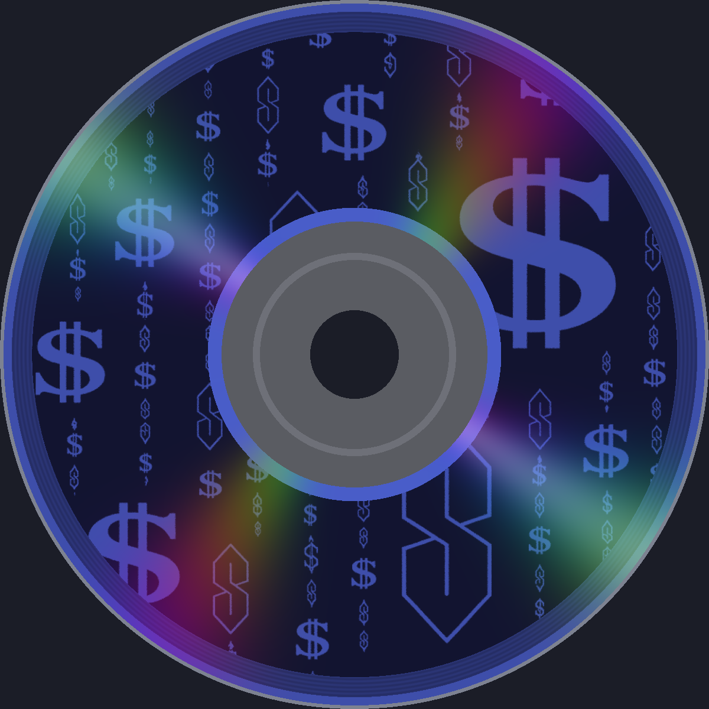
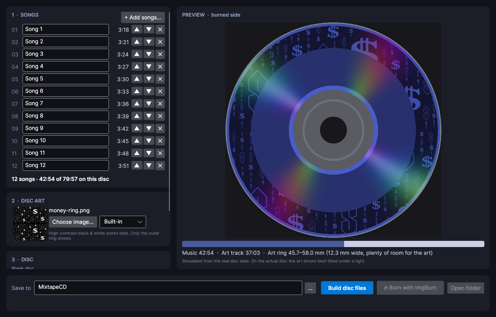

# Mixtape CD

Burn your mixtape to a CD **with a picture drawn into the burned side**. Tuned for
**Verbatim Silver Inkjet Printable CD-R** (DataLifePlus, AZO dye).

Two kinds of disc:

| | **MP3 disc** (default) | **Audio CD** |
| --- | --- | --- |
| Art on the burned side | almost the whole disc (~86% for 12 songs) | outer ring only |
| Songs stored as | your MP3 files, in a thin band at the edge | normal CD tracks in the middle |
| Plays on | computers, MP3-capable CD players, most car stereos since ~2005 | every CD player |
| Extra | `playlist.m3u` for the running order | last track is the picture and plays as noise |



*Simulated from the real generated disc data, drawn on a blue AZO dye surface. Real discs
show it best tilted under a light, and more subtly than this render.*

**Why can't songs and art share space?** The picture *is* the burned data pattern, so wherever
song data sits the disc shows plain texture. CD audio is uncompressed (about 10 MB per minute),
so 43 minutes fills over half the disc. As MP3s (about 2.4 MB per minute at 320 kbps), the same songs
take roughly 100 MB, a 3–4 mm band at the edge.

## The app (Windows)



1. Get the app: **Releases** (right side of the repo page) → download **MixtapeCD-windows.zip**
   and unzip it. It includes ffmpeg, so any audio file works. (Each push also builds a test copy
   under **Actions → build → MixtapeCD-windows**.)
2. Install [ImgBurn](https://www.imgburn.com/) (free) for the actual burning.
3. Run **MixtapeCD.exe** and:
   - **Songs**: drag in any audio files (MP3, WAV, FLAC, M4A/AAC, ALAC, OGG, Opus, AIFF, WMA,
     even video files) or click *Add songs…*. Titles and artists come from each file's tags; edit
     them and reorder with ▲▼.
   - **Disc**: *MP3 disc* and Verbatim AZO are preselected. Switch to *Audio CD* if it must play
     in old CD-only players.
   - **Disc art**: the money art is preselected; *Choose image…* to use your own (PNG, JPEG,
     WebP, BMP, GIF; any shape). *Fill the disc* crops it to a square, *Show the whole image* adds
     black borders.
   - Watch the **preview**: your image and the burned disc side by side. On the left, dimmed areas
     won't be on the disc and blue marks where the songs go; the right redraws the burned side
     whenever you change something. It warns if there's too much music.
4. **Build disc files**, then **Burn with ImgBurn**. ImgBurn opens with the disc (`.iso` for MP3
   discs, `mixtape.cue` for audio CDs) loaded; insert a blank, choose a slow speed and click Write.

Windows may show a SmartScreen warning the first time because the app isn't signed:
*More info → Run anyway*.

### Command line instead

MP3 disc: `mixtape-cd cd-mp3 --input art/money.png --music-dir ./songs --output-dir ./disc --title "My Mixtape"`

Audio CD:

```powershell
.\make-mixtape.ps1 -Songs "D:\Mixtape\songs" -Title "My Mixtape" -Artist "Me"
```
(from the **mixtape-cd-cli-win-x64** download; needs ffmpeg on PATH).
macOS/Linux: `./make-mixtape.sh ./songs`, burn with `cdrdao write disc/mixtape.cue`.

## Sound quality (MP3 disc)

The app converts automatically, picking the path with the least quality loss:

| Your file | What happens |
| --- | --- |
| MP3 | used **as-is**, zero loss (re-encoding an MP3 can only make it worse) |
| Lossless: WAV, FLAC, AIFF, ALAC, APE, WavPack… | encoded once to MP3 **320 kbps** with LAME's highest-quality mode |
| Other lossy: AAC/M4A, OGG, Opus, WMA… | converted to MP3 **320 kbps** to keep the extra loss as small as possible |

- Sample rates MP3 supports (44.1/48/32 kHz) are kept; hi-res files (88.2/96/192 kHz) are
  resampled to 44.1 kHz with a high-precision (SoX) resampler. Mono stays mono; surround folds to stereo.
- Song tags (title, artist) are kept, and track numbers/album are written so car stereos list
  songs properly. Tagging copies the audio unchanged.
- Space is not a concern: even 80 minutes at 320 kbps is about 190 MB, a ~6 mm band, leaving ~80%
  of the disc for the art. The *Sound quality* menu offers V0/192 kbps if you want a thinner band.

## What fits (audio CD mode)

An 80-minute disc is shared: **more music = thinner art ring.** On the Verbatim disc
(data area 24.8–58.0 mm):

| Music | Art ring | Notes |
| --- | --- | --- |
| 30 min | 41–58 mm | wide ring |
| 43 min (12 × 3.5 min) | 46–58 mm | the preview above |
| 60 min | 52–58 mm | thin band at the edge |
| 75+ min | almost none | too little room for art |

The tool refuses to build if the songs leave no room for the picture.

## Burning rules

- Burn **disc-at-once** from the `.cue` (ImgBurn does this by default for CUE files).
  Track-at-once adds link gaps that shift and smear the art.
- Don't let the burner add 2-second gaps, normalise or re-encode audio.
- The **last track is the picture and plays as loud noise**. It's titled
  "Disc Art (noise - do not play)". Turn the volume down if you skip to it.
- Turn on CD-Text in ImgBurn if your drive supports it, so players show titles.
- Test on a spare disc first. Burn speed: use the slowest speed the drive offers.

## The artwork

- `art/money-ring.png` (default): your money-rain image, tiled smaller so whole dollar signs fit
  the outer ring.
- `art/money.png`: the original scale; the big signs get cut by the music ring.
- Your own art: any square, high-contrast black-and-white image works best. Only the outer
  ring shows; the centre is covered by the music. Pass `-Art path\to\image.png`.

The printable top is separate: you can inkjet-print the same art on the label side too.

## Fine-tuning for your batch

The `verbatim-azo` geometry comes from a measured Verbatim AZO CD-R. Batches vary slightly;
if the art looks twisted or curved, override the radii, e.g. `--r0 24.84 --r1 58.02`, and
compare test burns. More detail in [docs/MIXTAPE.md](docs/MIXTAPE.md).

## Build from source

```sh
dotnet run --project src/MixtapeCd.App            # the app
dotnet publish src/DiscImageStudio.Cli -c Release -r win-x64 --self-contained -p:PublishSingleFile=true -o out
```

Needs the .NET 10 SDK. Commands: `mixtape-cd --help`, `mixtape-cd cd-mixtape --help`.

## Credits and license

A stripped-down fork (plus a new desktop app built with [Avalonia](https://avaloniaui.net/)) of [Disc Image Studio](https://github.com/JiaFeiMiao-K-Cat/DiscImageStudio)
by JiaFeiMiao-K-Cat and contributors, which does the actual disc-surface imaging. Licensed
GPL-3.0-or-later; see [LICENSE](LICENSE) and [LICENSE-NOTICE.md](LICENSE-NOTICE.md).
