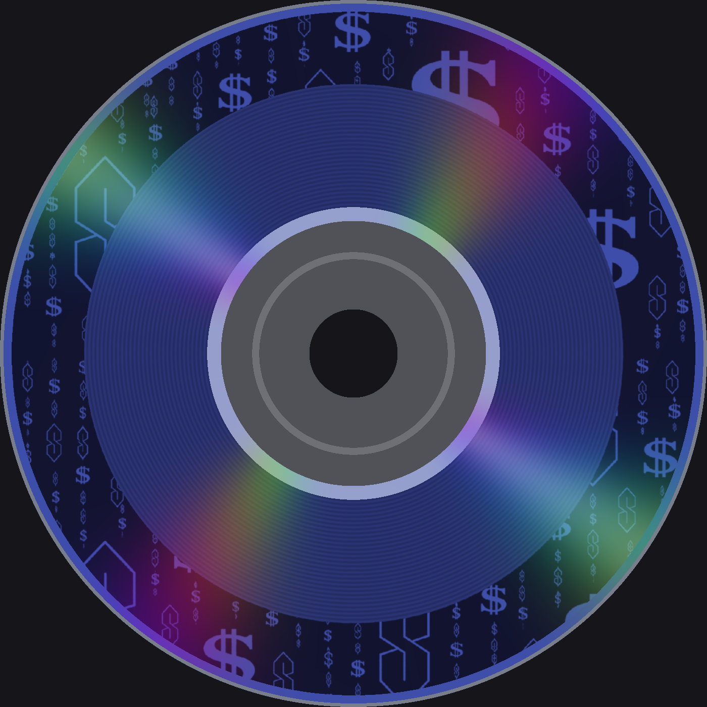

# Mixtape CD

Burn a **playable music CD that also has a picture on the burn side**. Your songs go on the
inner ring as normal audio tracks, and the artwork is drawn on the outer ring by a final
"disc art" track. Tuned for **Verbatim Silver Inkjet Printable CD-R** (DataLifePlus, AZO dye).



*Simulated readback of the real generated disc data, drawn on a blue AZO dye surface.
Real discs show it best tilted under a light, and more subtly than this render.*

## Quick start (Windows)

1. Install [ffmpeg](https://www.gyan.dev/ffmpeg/builds/) and [ImgBurn](https://www.imgburn.com/).
2. Get `mixtape-cd.exe`: open this repo's **Actions** tab → latest **build** run →
   download **mixtape-cd-win-x64** and unzip it. (Or build it: see below.)
3. Put your songs in a folder, named so they sort in order: `01 - Intro.mp3`, `02 - ...`.
4. In PowerShell, in the unzipped folder:
   ```powershell
   .\make-mixtape.ps1 -Songs "D:\Mixtape\songs" -Title "My Mixtape" -Artist "Me"
   ```
5. Open `disc\mixtape-preview.png` to check the layout (blue = music, image = art ring).
6. ImgBurn → **Write image file to disc** → open `disc\mixtape.cue` → burn.

macOS/Linux: `./make-mixtape.sh ./songs` (same steps; burn with `cdrdao write disc/mixtape.cue`).

## What fits

An 80-minute disc is shared: **more music = thinner art ring.** On the Verbatim disc
(data area 24.8–58.0 mm):

| Music | Art ring | Notes |
| --- | --- | --- |
| 30 min | 41–58 mm | wide ring |
| 43 min (12 × 3.5 min) | 46–58 mm | the preview above |
| 60 min | 52–58 mm | thin band at the edge |
| 75+ min | almost none | too little room for art |

The tool refuses to build if the songs leave no room for the picture.

## Burning rules

- Burn **disc-at-once** from the `.cue` (ImgBurn does this by default for CUE files).
  Track-at-once adds link gaps that shift and smear the art.
- Don't let the burner add 2-second gaps, normalise or re-encode audio.
- The **last track is the picture and plays as loud noise**. It's titled
  "Disc Art (noise - do not play)". Turn the volume down if you skip to it.
- Turn on CD-Text in ImgBurn if your drive supports it, so players show titles.
- Test on a spare disc first. Burn speed: use the slowest speed the drive offers.

## The artwork

- `art/money-ring.png` (default): your money-rain image, tiled smaller so whole dollar signs fit
  the outer ring.
- `art/money.png`: the original scale; the big signs get cut by the music ring.
- Your own art: any square, high-contrast black-and-white image works best. Only the outer
  ring shows; the centre is covered by the music. Pass `-Art path\to\image.png`.

The printable top is separate: you can inkjet-print the same art on the label side too.

## Fine-tuning for your batch

The `verbatim-azo` geometry comes from a measured Verbatim AZO CD-R. Batches vary slightly;
if the art looks twisted or curved, override the radii, e.g. `--r0 24.84 --r1 58.02`, and
compare test burns. More detail in [docs/MIXTAPE.md](docs/MIXTAPE.md).

## Build from source

```sh
dotnet publish src/DiscImageStudio.Cli -c Release -r win-x64 --self-contained -p:PublishSingleFile=true -o out
```

Needs the .NET 10 SDK. Commands: `mixtape-cd --help`, `mixtape-cd cd-mixtape --help`.

## Credits and license

A stripped-down fork of [Disc Image Studio](https://github.com/JiaFeiMiao-K-Cat/DiscImageStudio)
by JiaFeiMiao-K-Cat and contributors, which does the actual disc-surface imaging. Licensed
GPL-3.0-or-later; see [LICENSE](LICENSE) and [LICENSE-NOTICE.md](LICENSE-NOTICE.md).
